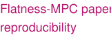

# <picture><source media="(prefers-color-scheme: dark)" srcset="assets/readme/text-name-dark.svg"></picture>

[<picture><source media="(prefers-color-scheme: dark)" srcset="assets/readme/text-cv-dark.svg"></picture>](https://github.com/johnnyzxc5/johnnyzxc5/blob/main/assets/Johnny_Garcia_Academic_CV.pdf) · [<picture><source media="(prefers-color-scheme: dark)" srcset="assets/readme/text-scholar-dark.svg"></picture>](https://scholar.google.com/citations?user=vLbm95EAAAAJ&hl=en) · [<picture><source media="(prefers-color-scheme: dark)" srcset="assets/readme/text-orcid-dark.svg"></picture>](https://orcid.org/0009-0005-9107-2951)

## <picture><source media="(prefers-color-scheme: dark)" srcset="assets/readme/text-publications-dark.svg"></picture>

| Preprint | Citation |
| --- | --- |
| [<picture><source media="(prefers-color-scheme: dark)" srcset="assets/readme/text-table-arxiv-dark.svg"></picture>](https://arxiv.org/abs/2610.33679) | J. Garcia, N. Salguero, N. Iqbal, B. Brahmi, and R. Rashad, "Energy-Based Fault Detection and Isolation Framework for Flat Port-Hamiltonian Mechanical Systems," *arXiv preprint*, 2026. |

## <picture><source media="(prefers-color-scheme: dark)" srcset="assets/readme/text-robotics-dark.svg"></picture>

| Project | What it contains |
| --- | --- |
| [<picture><source media="(prefers-color-scheme: dark)" srcset="assets/readme/text-table-glider-dark.svg"></picture>](https://github.com/GeoGliderLab/underwater-glider-geometric-simulator) | SE(3) floating-base dynamics with moving internal masses, variable buoyancy, and MATLAB simulation. |
| [<picture><source media="(prefers-color-scheme: dark)" srcset="assets/readme/text-table-panda-dark.svg"></picture>](https://github.com/johnnyzxc5/Franka-Panda-Geometric-Simulator) | Two formulations of 7-DoF robot dynamics: joint coordinates and global (S¹)⁷, with spatial RNEA and numerical validation. |
| [<picture><source media="(prefers-color-scheme: dark)" srcset="assets/readme/text-table-kinova-dark.svg"></picture>](https://github.com/johnnyzxc5/Kinova-Gen3-Geometric-Simulator) | Joint-coordinate and global (S¹)⁶ dynamics for a 6-DoF manipulator, including continuous-joint topology and numerical benchmarks. |

## <picture><source media="(prefers-color-scheme: dark)" srcset="assets/readme/text-reproducibility-dark.svg"></picture>

| Project | What it contains |
| --- | --- |
| [<picture><source media="(prefers-color-scheme: dark)" srcset="assets/readme/text-table-shape-dark.svg"></picture>](https://github.com/johnnyzxc5/SHAPE-paper-reproducibility) | Energy-based robot fault diagnosis using port-Hamiltonian modeling and physics-guided learning, with reproducibility resources. |
| [<picture><source media="(prefers-color-scheme: dark)" srcset="assets/readme/text-table-flatness-dark.svg"></picture>](https://github.com/johnnyzxc5/Flatness-MPC-paper-reproducibility) | Reproducible Flatness/LTV predictive-control simulations for robotic manipulators under actuator degradation, with table and figure generators. |
| [<picture><source media="(prefers-color-scheme: dark)" srcset="assets/readme/text-table-energy-dark.svg"></picture>](https://github.com/johnnyzxc5/ENERGY-paper-reproducibility) | Reproducible MATLAB analysis of wind-powered hydrogen potential across regions of Saudi Arabia. |

## <picture><source media="(prefers-color-scheme: dark)" srcset="assets/readme/text-tools-dark.svg"></picture>

| Project | What it contains |
| --- | --- |
| [<picture><source media="(prefers-color-scheme: dark)" srcset="assets/readme/text-table-literature-dark.svg"></picture>](https://github.com/johnnyzxc5/literature-scout) | Academic literature discovery, local model screening, Zotero export, and optional NotebookLM integration. |
| [<picture><source media="(prefers-color-scheme: dark)" srcset="assets/readme/text-table-revision-dark.svg"></picture>](https://github.com/johnnyzxc5/paper-revision-skill) | Evidence-grounded assistance for scientific writing and manuscript revision. |
| [<picture><source media="(prefers-color-scheme: dark)" srcset="assets/readme/text-table-compass-dark.svg"></picture>](https://github.com/johnnyzxc5/phd-compass) | A local workspace for evidence-based PhD lab and supervisor research. |

Repository READMEs document assumptions, validation results, and licensing. Code licenses do not extend to manuscripts or third-party assets.
