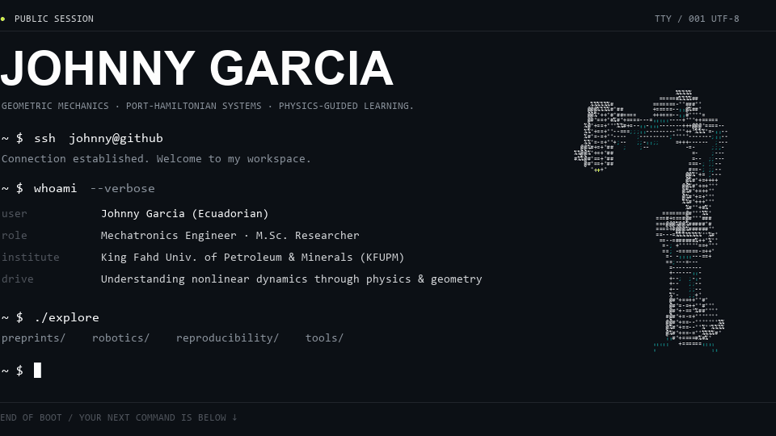

<!-- JOHNNY GARCIA // ACADEMIC RESEARCH PROFILE -->

<picture>
  
</picture>

<!-- INTERACTIVE TERMINAL COMMAND: CLICKABLE ACADEMIC IDENTIFIERS -->
<div align="left" style="margin-top: 10px; margin-bottom: 24px;">
  <code>~ $ open</code> &nbsp;
  <a href="https://github.com/johnnyzxc5/johnnyzxc5/blob/main/assets/Johnny_Garcia_Academic_CV.pdf"><code>[ Academic CV (PDF) ] ↗</code></a> &nbsp;·&nbsp;
  <a href="https://scholar.google.com/citations?user=vLbm95EAAAAJ&hl=en"><code>[ Google Scholar ] ↗</code></a> &nbsp;·&nbsp;
  <a href="https://www.linkedin.com/in/johnnygarciabet/"><code>[ LinkedIn ] ↗</code></a>
</div>

<br/>

<!-- SECTION 01: PUBLICATIONS & PREPRINTS -->
<picture></picture>

<a href="https://arxiv.org/abs/2610.33679">
  <picture></picture>
</a>

<details>
  <summary><code>❯ ./cat citation_bibtex.txt</code></summary>

```bibtex
@article{garcia2026energy,
  title   = {Energy-Based Fault Detection and Isolation Framework for Flat Port-Hamiltonian Mechanical Systems},
  author  = {Garcia, Johnny and Salguero, Nicolas and Iqbal, Noman and Brahmi, Brahim and Rashad, Ramy},
  journal = {arXiv preprint arXiv:2610.33679},
  year    = {2026},
  url     = {https://arxiv.org/abs/2610.33679}
}
```

</details>

<br/>

<!-- SECTION 02: GEOMETRIC ROBOTICS & SIMULATION -->
<picture></picture>

<a href="https://github.com/GeoGliderLab/underwater-glider-geometric-simulator">
  <picture></picture>
</a>
<a href="https://github.com/johnnyzxc5/Franka-Panda-Geometric-Simulator">
  <picture></picture>
</a>
<a href="https://github.com/johnnyzxc5/Kinova-Gen3-Geometric-Simulator">
  <picture></picture>
</a>

<br/>

<!-- SECTION 03: RESEARCH & REPRODUCIBILITY -->
<picture></picture>

<a href="https://github.com/johnnyzxc5/SHAPE-paper-reproducibility">
  <picture></picture>
</a>
<a href="https://github.com/johnnyzxc5/Flatness-MPC-paper-reproducibility">
  <picture></picture>
</a>
<a href="https://github.com/johnnyzxc5/ENERGY-paper-reproducibility">
  <picture></picture>
</a>

<br/>

<!-- SECTION 04: RESEARCH TOOLS & WORKFLOWS -->
<picture></picture>

<a href="https://github.com/johnnyzxc5/literature-scout">
  <picture></picture>
</a>
<a href="https://github.com/johnnyzxc5/paper-revision-skill">
  <picture></picture>
</a>
<a href="https://github.com/johnnyzxc5/phd-compass">
  <picture></picture>
</a>

<br/>

<!-- RESEARCH STACK JSON DRAWER -->
<details>
  <summary><code>~ $ cat research_stack.json</code></summary>

```json
{
  "researcher": "Johnny Garcia",
  "origin": "Ecuador",
  "institution": "King Fahd University of Petroleum & Minerals (KFUPM)",
  "domains": [
    "Differential Geometry on Lie Groups SE(3)",
    "Flat Port-Hamiltonian Mechanical Systems (pHMS)",
    "Energy-Based Fault Detection & Isolation (FDI)",
    "Flatness/LTV Model Predictive Control"
  ],
  "toolchain": [
    "Python",
    "C++",
    "PyTorch",
    "MATLAB",
    "Simulink",
    "SolidWorks (CAD)",
    "ANSYS (CAE)"
  ],
  "publications": [
    "arXiv:2610.33679"
  ]
}
```

</details>

<br/>

<div align="center">
  <sub><code>// REPOSITORY READMEs DOCUMENT NUMERICAL BENCHMARKS, ASSUMPTIONS, AND SCIENTIFIC LICENSING //</code></sub>
</div>
